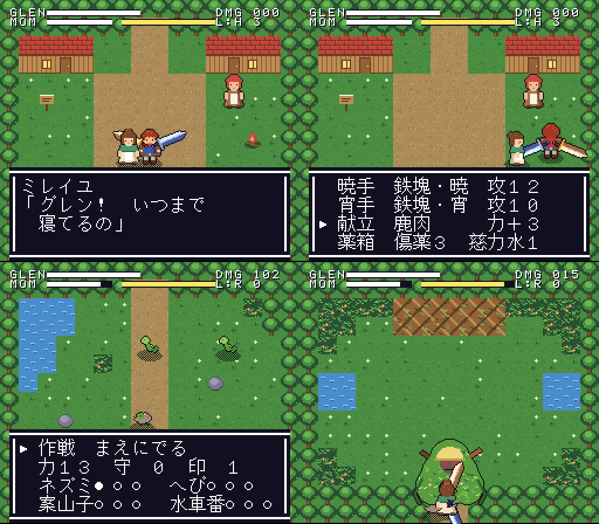
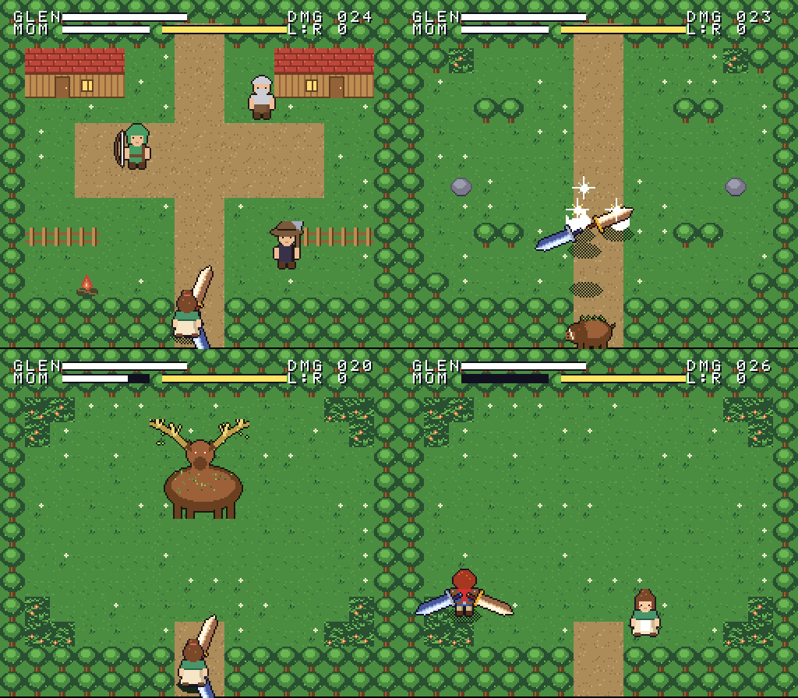

# ゆりかごの双刃（ふたば） / CRADLE EDGE（仮題）

スーパーファミコン（SNES）実機互換のエミュレータで動作する、オリジナルの2DアクションRPG。
「1990年代半ば、国内大手パブリッシャーから出ていたかもしれない」空気感を目標にした**完全新作**です。

| 項目 | 内容 |
|---|---|
| ジャンル | アクションRPG（見下ろし型） |
| プレイ人数 | 1人 |
| 想定プレイ時間 | 約10時間（第一版） |
| 対象ハード | SNES / スーパーファミコン（NTSC-J）、LoROM 16Mbit + バッテリーバックアップ |
| 状態 | 仕様書 第0.1版 ／ **序章＋第一章「溺れ森」まで遊べる（M5 途中）** |

## 遊ぶ（序章＋第一章）





`dist/cradle-edge.sfc` を SNES エミュレータ（Mesen 2 / bsnes / Snes9x など）で開いてください。
序章（村 → 裏山 → 水車小屋のボス）のあと村へ戻り、東の街道から第一章「溺れ森」（街道 → 森 → 狩人の集落 → 森の奥 → 千年角の大鹿）へ続きます。通しで30〜40分ほどです。

| ボタン | 動作 |
|---|---|
| 十字キー | 移動（8方向）。画面端の道の切れ目から隣の画面へ |
| Y | 連斬（押し足して最大4段）。人・立て札・焚き火・箱の前では「話す／調べる」 |
| Y 長押し→離す | 溜め斬り。0.6秒で「双牙落とし」、1.4秒で「地裂き」（剣が光ったら溜まった合図） |
| B | 回避ステップ。敵の攻撃を引きつけて避けるとジャスト回避、直後の Y で返し刃 |
| A | 母に「癒やして」（詠唱1秒）。入れすぎると「癒え焼け」 |
| X（短く） | 母がいちばん近い敵に過治癒。ゲージが満ちると崩壊 |
| X（長押し） | 母に「殴って！」。いちばん近い敵へ走って整骨拳 |
| L / SELECT | 薬を使う／薬の種類を切り替える（画面右上 `L:H 3` = 傷薬あと3つ） |
| START | 一時停止：母の作戦の切り替え、力・守・見切り印の確認 |
| 倒れた母のそばで A 長押し | 助け起こす（放っておいても15秒で起きる） |

**焚き火の支度**（休むと開く。上下で選び、A で切り替え、B で終える）

| 項目 | 選べるもの |
|---|---|
| 暁手／宵手 | 持っている大剣から1本ずつ。攻撃力と重さ（重いほど振りが遅い）が変わる。裏山の箱に「苔断ち」（再生する敵に強い） |
| 献立 | 鹿肉（力+3）／根菜煮（守+3）／茸飯（慈力の戻りが倍） |
| 薬箱 | 傷薬3・慈力水1／傷薬2・慈力水2／傷薬2・気付け薬2／傷薬4。休むたびに詰め直し |

**成長**：レベルはありません。敵の攻撃をジャスト回避するたび、その敵の種類に「見切り印」がつきます（最大3）。印の合計3つごとに力+1。印が3つ揃った敵は回避の受付が広がり、返し刃が1.5倍になります。

**母の作戦**（START）：よりそう（HP が40を切ると勝手に癒やす）／まえにでる（近くの敵を殴りに行く）／さがってて（詠唱中以外は狙われず、慈力の戻りが速い）。

**曲**：村・野外・ボスの3曲（仮）。

**第一章の敵**：茂み猪（突進。壁にぶつけると目を回す）／花蜂／胞子茸（動かないが周りに胞子）／眠らぬ番犬（癒え残り。斬って倒しても5秒で起き上がる。倒れているうちに母の過治癒で崩壊させると「送れる」）／千年角の大鹿（ボス。突進と踏みつけ、蜂を呼ぶ。壁際に誘って突進させると目を回す）。

まだ無いもの：砥石・切れ味、毒などの状態異常、古傷（ボスで最大HP上昇）、2章以降。絵・効果音・曲はすべてコードで作った仮素材です。

## ビルド

```
sudo apt install cc65 libretro-snes9x fonts-unifont   # アセンブラ、テスト用エミュレータコア、日本語フォント
make            # build/cradle-edge.sfc
make test       # ヘッドレスで起動し、タイトルからボス撃破・記録・再開までを自動検証
```

## ドキュメント

1. [ゲームデザイン仕様書](docs/01_game_design.md) — 操作、バトル、成長、準備、数値、敵、アイテム
2. [世界設定・シナリオ](docs/02_world_story.md) — 世界観、登場人物、章立て、結末
3. [技術仕様書](docs/03_technical.md) — ROM構成、描画、サウンド、メモリ、開発環境、ロードマップ
4. [自己判断・未決事項の一覧](docs/04_decisions.md) — おまかせで決めた点と、決めてほしい点

## 一行コンセプト

> **癒やしすぎた世界を、母の手と息子の刃で、もう一度「傷つける」物語。**

## 権利上の注意

- ゲーム内の日本語フォントは GNU Unifont（SIL Open Font License 1.1 / GPLv2+ フォント例外）の字形を、台本に出てくる文字だけタイル化して収録しています。

- 実在の企業名・ロゴ・既存作品のキャラクター／音楽／マップ／グラフィックは一切使用しません。
  「在りし日のエニックス風」はあくまで**作風の目標**であり、ROM内・パッケージ表記には架空の発売元名を使います。
