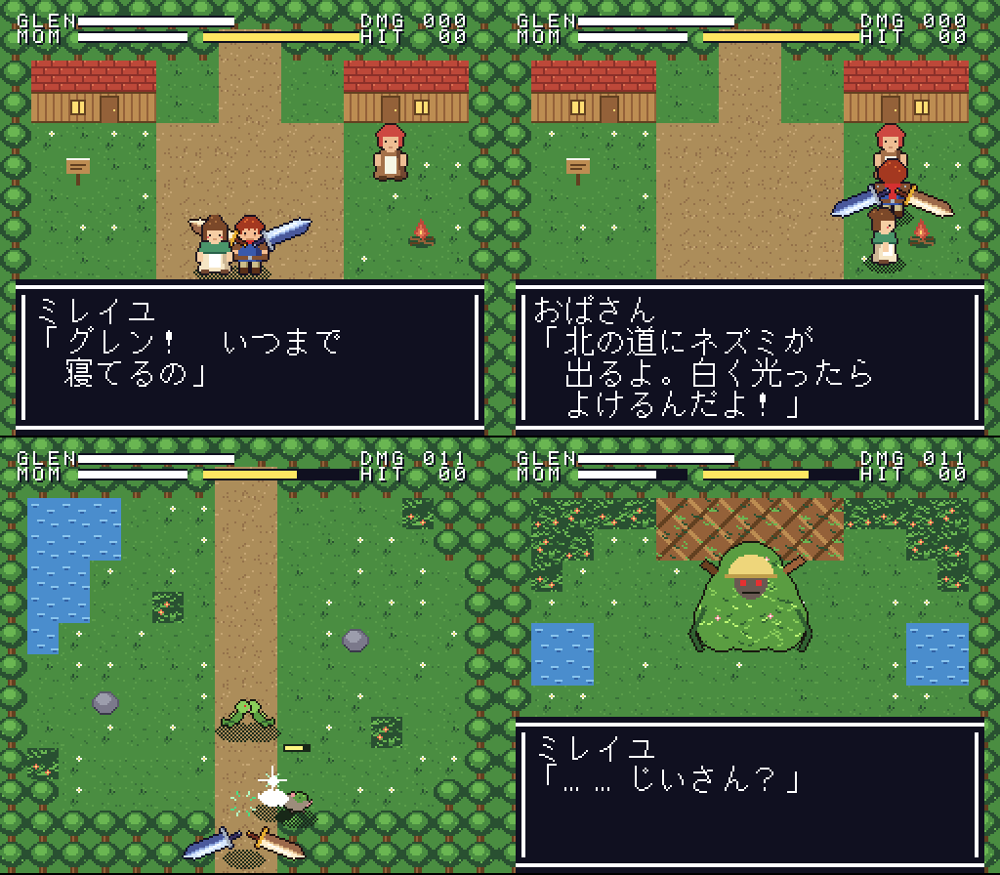

# ゆりかごの双刃（ふたば） / CRADLE EDGE（仮題）

スーパーファミコン（SNES）実機互換のエミュレータで動作する、オリジナルの2DアクションRPG。
「1990年代半ば、国内大手パブリッシャーから出ていたかもしれない」空気感を目標にした**完全新作**です。

| 項目 | 内容 |
|---|---|
| ジャンル | アクションRPG（見下ろし型） |
| プレイ人数 | 1人 |
| 想定プレイ時間 | 約10時間（第一版） |
| 対象ハード | SNES / スーパーファミコン（NTSC-J）、LoROM 16Mbit + バッテリーバックアップ |
| 状態 | 仕様書 第0.1版 ／ **M3（序章の縦切り：タイトルからボスまで）まで実装** |

## 遊ぶ（M3 序章の縦切り）



`dist/cradle-edge-m3.sfc` を SNES エミュレータ（Mesen 2 / bsnes / Snes9x など）で開いてください。
タイトル → 村 → 村はずれ → 裏山 → 水車小屋（ボス）まで、通しで10〜15分ほどです。

| ボタン | 動作 |
|---|---|
| 十字キー | 移動（8方向）。画面端の道の切れ目から隣の画面へ |
| Y | 連斬（押し足して最大4段）。人・立て札・焚き火の前では「話す／調べる」 |
| Y 長押し→離す | 溜め斬り。0.6秒で「双牙落とし」、1.4秒で「地裂き」（剣が光ったら溜まった合図） |
| B | 回避ステップ。敵の攻撃を引きつけて避けるとジャスト回避、直後の Y で返し刃 |
| A | 母に「癒やして」（詠唱1秒）。入れすぎると「癒え焼け」 |
| X | 母がいちばん近い敵に過治癒。ゲージが満ちると崩壊 |
| 倒れた母のそばで A 長押し | 助け起こす（放っておいても15秒で起きる） |
| 会話中 A / B / Y | 次へ |

- 焚き火（村と裏山に1つずつ）で全快して記録。倒れると最後の焚き火から。記録はバッテリーバックアップに保存され、タイトルの「つづきから」で再開できます。
- 母が詠唱を始めると敵は母を狙います。蔓へびは常に母狙い。詠唱は殴られると中断します。
- ボス「茂みに呑まれた水車番」は HP が再生し続けます。過治癒で崩壊させて再生を止めるのが攻略の筋です。

まだ無いもの：BGM、準備画面（剣・砥石・薬・護符・献立）、見切り印などの成長、メニュー。絵と効果音はすべてコード生成の仮素材です。

## ビルド

```
sudo apt install cc65 libretro-snes9x fonts-unifont   # アセンブラ、テスト用エミュレータコア、日本語フォント
make            # build/cradle-edge.sfc
make test       # ヘッドレスで起動し、タイトルからボス撃破・記録・再開までを自動検証
```

## ドキュメント

1. [ゲームデザイン仕様書](docs/01_game_design.md) — 操作、バトル、成長、準備、数値、敵、アイテム
2. [世界設定・シナリオ](docs/02_world_story.md) — 世界観、登場人物、章立て、結末
3. [技術仕様書](docs/03_technical.md) — ROM構成、描画、サウンド、メモリ、開発環境、ロードマップ
4. [自己判断・未決事項の一覧](docs/04_decisions.md) — おまかせで決めた点と、決めてほしい点

## 一行コンセプト

> **癒やしすぎた世界を、母の手と息子の刃で、もう一度「傷つける」物語。**

## 権利上の注意

- ゲーム内の日本語フォントは GNU Unifont（SIL Open Font License 1.1 / GPLv2+ フォント例外）の字形を、台本に出てくる文字だけタイル化して収録しています。

- 実在の企業名・ロゴ・既存作品のキャラクター／音楽／マップ／グラフィックは一切使用しません。
  「在りし日のエニックス風」はあくまで**作風の目標**であり、ROM内・パッケージ表記には架空の発売元名を使います。
