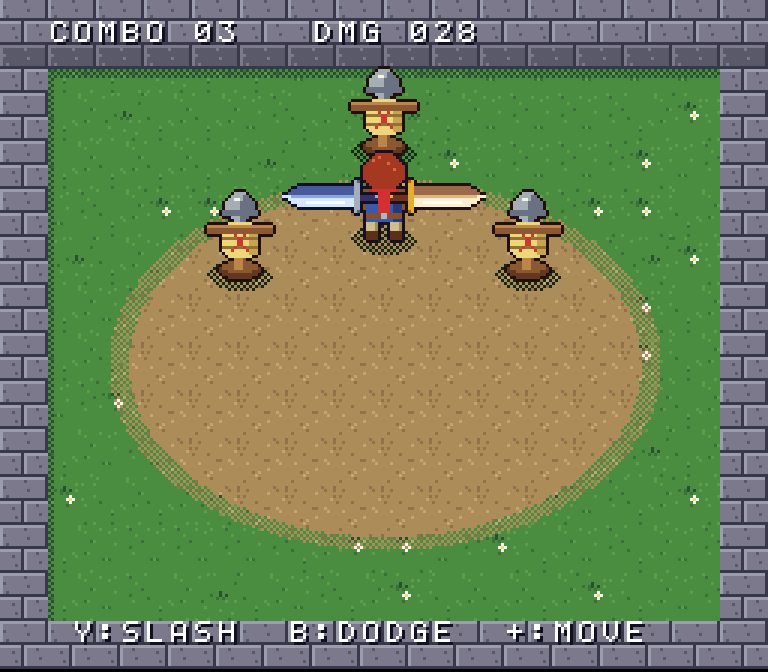

# ゆりかごの双刃（ふたば） / CRADLE EDGE（仮題）

スーパーファミコン（SNES）実機互換のエミュレータで動作する、オリジナルの2DアクションRPG。
「1990年代半ば、国内大手パブリッシャーから出ていたかもしれない」空気感を目標にした**完全新作**です。

| 項目 | 内容 |
|---|---|
| ジャンル | アクションRPG（見下ろし型） |
| プレイ人数 | 1人 |
| 想定プレイ時間 | 約10時間（第一版） |
| 対象ハード | SNES / スーパーファミコン（NTSC-J）、LoROM 16Mbit + バッテリーバックアップ |
| 状態 | 仕様書 第0.1版 ／ **M1 技術試作（歩く・斬る・吹き飛ぶ）まで実装** |

## 遊ぶ（M1 技術試作）



`dist/cradle-edge-m1.sfc` を SNES エミュレータ（Mesen 2 / bsnes / Snes9x など）で開いてください。

| ボタン | 動作 |
|---|---|
| 十字キー | 移動（8方向） |
| Y | 連斬（タイミングよく押し足すと最大4段。4段目で吹き飛ばす） |
| B | 回避ステップ（方向なしで後ろへ） |

M1 に入っているもの：1部屋、主人公、大剣2本の振り、木人3体、ヒットストップ、吹き飛ばしと玉突き、画面揺れ、コンボ／ダメージ表示。
まだ無いもの：音、母、敵、溜め斬り、ジャスト回避、メニュー、セーブ。絵はすべてコード生成の仮素材です。

## ビルド

```
sudo apt install cc65 libretro-snes9x     # アセンブラと、テスト用エミュレータコア
make            # build/cradle-edge.sfc
make test       # ヘッドレスで起動し、歩行・連斬・吹き飛ばしを自動検証
```

## ドキュメント

1. [ゲームデザイン仕様書](docs/01_game_design.md) — 操作、バトル、成長、準備、数値、敵、アイテム
2. [世界設定・シナリオ](docs/02_world_story.md) — 世界観、登場人物、章立て、結末
3. [技術仕様書](docs/03_technical.md) — ROM構成、描画、サウンド、メモリ、開発環境、ロードマップ
4. [自己判断・未決事項の一覧](docs/04_decisions.md) — おまかせで決めた点と、決めてほしい点

## 一行コンセプト

> **癒やしすぎた世界を、母の手と息子の刃で、もう一度「傷つける」物語。**

## 権利上の注意

- 実在の企業名・ロゴ・既存作品のキャラクター／音楽／マップ／グラフィックは一切使用しません。
  「在りし日のエニックス風」はあくまで**作風の目標**であり、ROM内・パッケージ表記には架空の発売元名を使います。
